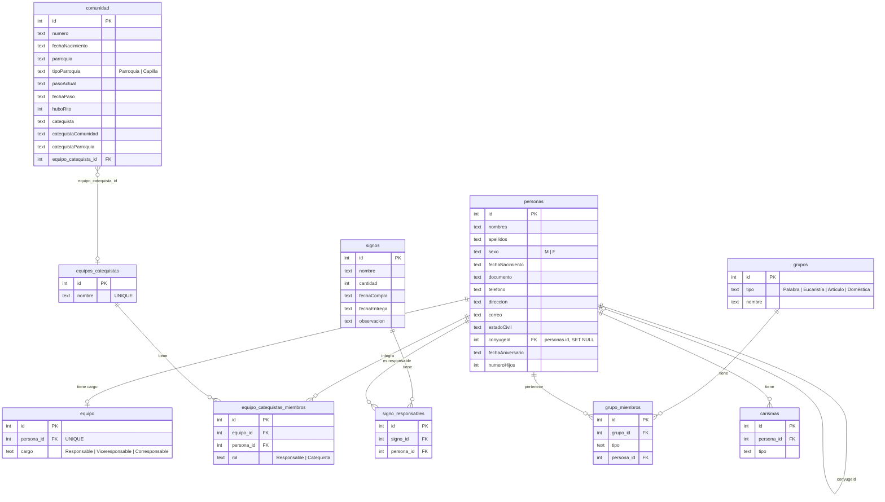

# Diseño de base de datos (SQLite, versión 3)

Todo se construye a partir de **personas**: primero se registran los hermanos y
después se usan para formar el equipo, los equipos de catequistas, los
responsables de signos, los grupos y los carismas.

## Reglas

| Tabla | Restricción | Para qué |
|---|---|---|
| `equipo` | `UNIQUE(persona_id)` | Una persona tiene un solo cargo (la app además garantiza un único Responsable). |
| `equipo_catequistas_miembros` | `UNIQUE(equipo_id, persona_id)` | Sin duplicados en un equipo; una persona puede estar en varios equipos. |
| `signo_responsables` | `UNIQUE(signo_id, persona_id)` | Varios responsables por signo. |
| `grupos` | `UNIQUE(tipo, nombre)` | Grupos numerados por tipo. |
| `grupo_miembros` | `UNIQUE(tipo, persona_id)` | Una persona está en **un** grupo de cada tipo (puede estar en uno de Palabra y otro de Eucaristía). |
| `carismas` | `UNIQUE(persona_id, tipo)` | Varios carismas por persona, sin repetir. |
| `personas.conyugeId` | se mantiene en ambos sentidos | Al casar a A con B, B apunta a A. El reparto de grupos mantiene juntos a los matrimonios. |

Todas las FK hacia `personas` usan `ON DELETE CASCADE`: al eliminar una persona
desaparece de equipos, grupos, signos y carismas.

## Migración desde v1

`DBHelper._migrarV2` conserva los datos existentes:

- `equipo`: se eliminan duplicados (queda el cargo más reciente por persona).
- `grupo_persona` (un único grupo genérico) pasa a `grupos` / `grupo_miembros` como tipo **Palabra**.
- `carismas`: se recrea con cascada y sin duplicados.
- Se añaden `personas.sexo`, `comunidad.equipo_catequista_id` y la tabla `signo_responsables`.
- v3: se añaden `comunidad.catequistaComunidad` y `comunidad.catequistaParroquia`.
